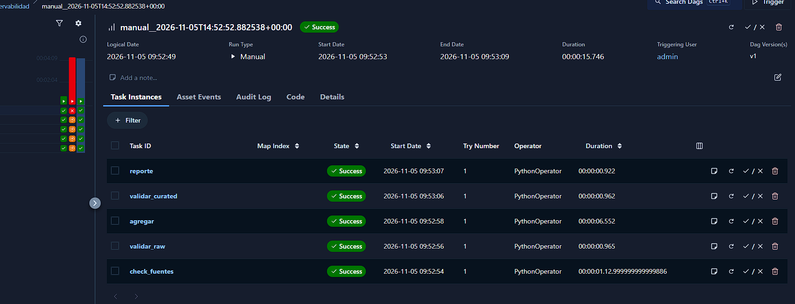
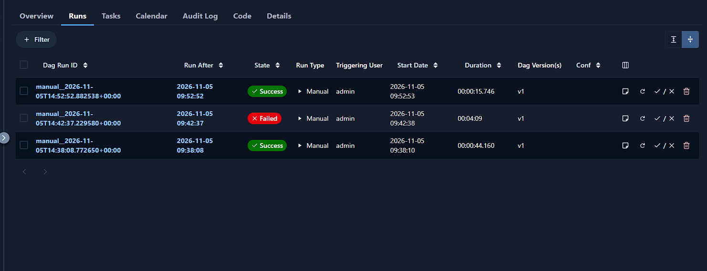

# RapidGo — Observabilidad Tecnológica

**Proyecto Final de Big Data · Variante 9 — Observabilidad tecnológica**

Pipeline end-to-end para detectar la degradación de las APIs y servicios de RapidGo: eventos operacionales → Kafka → Spark Structured Streaming → Data Lake → Airflow → KPIs y alertas.

- **Release final:** [`v1.0.0`](https://github.com/Sebas7ianRamirez/RapidGo_Proyecto-Final/releases/tag/v1.0.0)
- **Video final (máx. 10 min):** [Ver video final de RapidGo — Observabilidad Tecnológica en YouTube](https://youtu.be/2MTgeLMxYoc) 

## Contenido

1. [Equipo](#equipo)
2. [Problema de negocio y valor de la solución](#problema-de-negocio-y-valor-de-la-solución)
3. [Arquitectura](#arquitectura)
4. [Tecnologías y su rol](#tecnologías-y-su-rol)
5. [Topic, eventos, KPIs y reglas de alerta](#topic-eventos-kpis-y-reglas-de-alerta)
6. [Cómo ejecutarlo desde cero](#cómo-ejecutarlo-desde-cero)
7. [Pruebas y GitHub Actions](#pruebas-y-github-actions)
8. [Airflow: acceso y ejecución del DAG](#airflow-acceso-y-ejecución-del-dag)
9. [Resultados y evidencias](#resultados-y-evidencias)
10. [Limitaciones conocidas y trabajo futuro](#limitaciones-conocidas-y-trabajo-futuro)
11. [Decisiones técnicas y checkpoints](#decisiones-técnicas-y-checkpoints)
12. [Contribuciones](#contribuciones)

## Equipo

| Integrante | Usuario de GitHub | Responsabilidades principales |
|---|---|---|
| Juan Sebastián Organista Ramirez | [@Sebas7ianRamirez](https://github.com/Sebas7ianRamirez) | Kafka (topic y ADR-001), producer, Spark en Docker, Airflow y DAG, integración final, README y releases |
| Joseph Santiago Morales Carrillo | [@JsantiagoM21](https://github.com/JsantiagoM21) | Contrato de datos, KPIs y alertas, Spark Structured Streaming, pruebas de reglas, validación del DAG en CI, ADR-004 |
| Richard Jesus Chachalo Madriñan | [@RichardChachalo](https://github.com/RichardChachalo) | Arquitectura, Docker Compose base, pruebas, CI y quality gate, ADR-002 y ADR-003, fallo controlado, checkpoints y README final |

## Problema de negocio y valor de la solución

RapidGo necesita detectar a tiempo la degradación de sus APIs y servicios. Hoy no existe una visión unificada de errores, latencia y disponibilidad por servicio, lo que retrasa la detección de incidentes y la reacción.

**Valor de la solución:** el sistema captura los eventos de `pedidos-api`, `pagos-api`, `tracking-api` y `usuarios-api`, calcula en ventanas de un minuto el error rate y la latencia p95 por servicio, y marca como alerta los servicios que superan los umbrales. Además, un DAG de Airflow valida la calidad de cada capa del Data Lake y genera un reporte final de la ejecución.

## Arquitectura


```text
Generador de eventos -> Kafka -> Spark Structured Streaming -> Data Lake -> Airflow -> Reporte y alertas
```

- **Generador de eventos (producer):** simula tráfico de los cuatro servicios, con escenarios de anomalía configurables.
- **Kafka:** transporta los eventos por el topic `rapidgo.observabilidad.eventos`.
- **Spark Structured Streaming:** valida y parsea los eventos, calcula KPIs por ventana y evalúa las alertas.
- **Data Lake:** `datalake/processed/eventos` (eventos válidos) y `datalake/curated/kpis_alertas` (KPIs y alertas), ambos en Parquet.
- **Airflow:** valida las fuentes, agrega métricas, valida `curated` y genera el reporte final.

Más detalle en [`docs/arquitectura.md`](docs/arquitectura.md).

## Tecnologías y su rol

| Tecnología | Versión | Rol en el proyecto |
|---|---|---|
| Python | 3.12 | Producer de eventos, pruebas y lógica del DAG |
| confluent-kafka | 2.16.0 | Cliente del producer para publicar en Kafka |
| Apache Kafka | 4.3.1 (KRaft, 1 broker) | Transporte de eventos y desacople entre producer y Spark |
| Apache Spark | 3.5.1 (Structured Streaming) | Procesamiento en tiempo casi real: validación, ventanas, KPIs y alertas |
| Parquet | — | Formato de almacenamiento del Data Lake |
| Apache Airflow | 3.3.1 (standalone, SQLite) | Orquestación: calidad, agregación y reporte, con reintentos y XCom |
| Pandas / PyArrow | — | Lectura de Parquet dentro del DAG |
| Docker y Docker Compose | Compose v2 | Entorno reproducible (perfiles `spark` y `airflow`) |
| pytest y jsonschema | 9.2.0 / 4.26.0 | Pruebas del contrato, el producer, las reglas y el DAG |
| GitHub Actions | — | CI y quality gate |

## Topic, eventos, KPIs y reglas de alerta

**Topic de Kafka** (decisión en [ADR-001](docs/decisions/ADR-001-kafka-topic-key-particiones.md)):

| Propiedad | Valor |
|---|---|
| Nombre | `rapidgo.observabilidad.eventos` |
| Particiones / replicación | 3 / 1 |
| Key del mensaje | `servicio` (los eventos de un servicio conservan su orden) |
| Acceso desde el host | `localhost:9092`; dentro de Docker, `kafka:19092` |

**Evento** (esquema en [`samples/contrato_evento.schema.json`](samples/contrato_evento.schema.json)): `event_id`, `timestamp`, `servicio`, `endpoint`, `metodo_http`, `codigo_http`, `latencia_ms`, `region`, `instancia`.

**KPIs** (detalle en [`docs/kpis_alertas.md`](docs/kpis_alertas.md)):

| KPI | Definición | Referencia normal |
|---|---|---|
| Error rate | Eventos con `codigo_http >= 500` sobre el total de la ventana, por servicio | ≤ 5 % (ventana de 1 min) |
| Latencia p95 | Percentil 95 de `latencia_ms` por servicio | ≤ 2000 ms (ventana de 1 min) |
| Disponibilidad | `1 - error_rate` (aproximación basada en errores 5xx) | ≥ 98 % |

**Reglas de alerta:**

| Alerta | Condición | Severidad |
|---|---|---|
| Error alto | `error_rate > 5 %` en una ventana de 1 minuto | Alta |
| Latencia crítica | `p95_latencia_ms > 2000` en una ventana de 1 minuto | Alta |

## Cómo ejecutarlo desde cero

### Prerrequisitos

- Git.
- Docker Desktop o Docker Engine con Docker Compose v2.
- Python 3.12 o superior.
- Conexión a internet en el primer arranque (imágenes y dependencias de Spark).
- Puertos libres: `9092` (Kafka) y `8088` (Airflow).
- Memoria: con los tres servicios activos y en reposo se midieron unos 3,1 GiB en total, así que conviene asignar a Docker al menos 4 GB (la documentación de Airflow pide ese mínimo). Ver [Resultados](#resultados-y-evidencias).

### 1. Clonar y preparar Python

```powershell
git clone https://github.com/Sebas7ianRamirez/RapidGo_Proyecto-Final.git
cd RapidGo_Proyecto-Final
python -m venv .venv
.\.venv\Scripts\Activate.ps1
pip install -r requirements.txt
```

En Linux o macOS:

```bash
python3 -m venv .venv
source .venv/bin/activate
pip install -r requirements.txt
```

### 2. Iniciar Kafka y crear el topic

```powershell
docker compose up -d
docker compose ps -a
```

Verifica que `kafka` esté `Up (healthy)`, que `kafka-init` termine en `Exited (0)` y que `spark-streaming` y `airflow` sigan detenidos.

### 3. Iniciar Spark antes del producer

```powershell
docker compose --profile spark up -d spark-streaming
docker compose logs -f spark-streaming
```

Espera hasta ver `Batch: 0`. Spark lee solo los eventos publicados después de su arranque (`startingOffsets=latest`). Sal del log con `Ctrl+C`; Spark sigue corriendo.

### 4. Generar eventos

En otra terminal, con el mismo entorno virtual:

```powershell
python -m producer.main --tasa 5 --max-eventos 1500
```

Son unos 5 minutos de ejecución. La capa `curated` se escribe cuando se cierran las ventanas, con un watermark de 2 minutos, así que ejecuciones muy cortas (por ejemplo 300 eventos) no la llenan. Para provocar una anomalía de latencia en `pagos-api`:

```powershell
python -m producer.main --tasa 5 --escenario latencia_alta --anomalia-inicio 60 --anomalia-duracion 180 --max-eventos 1500
```

### 5. Verificar el Data Lake

```powershell
python scripts\verificar_pipeline.py
```

El script cuenta los Parquet de `processed` y `curated` sin modificar datos y consulta Airflow en el puerto 8088 (muestra una advertencia si Airflow está apagado). También puedes contarlos a mano:

```powershell
(Get-ChildItem datalake\processed -Recurse -Filter *.parquet).Count
(Get-ChildItem datalake\curated -Recurse -Filter *.parquet).Count
```

```bash
find datalake/processed -name "*.parquet" | wc -l
find datalake/curated -name "*.parquet" | wc -l
```

Si `curated` aún muestra cero, sigue generando eventos y revisa de nuevo en unos minutos.

### 6. Iniciar Airflow y ejecutar pruebas

Los pasos de Airflow están en [la sección de Airflow](#airflow-acceso-y-ejecución-del-dag) y las pruebas en [Pruebas y GitHub Actions](#pruebas-y-github-actions).

### Detener sin perder datos

```powershell
docker compose --profile spark --profile airflow stop
docker compose --profile spark --profile airflow start   # para reanudar
```

`docker compose down` elimina los contenedores: se pierden los mensajes del topic y el historial de Airflow (SQLite dentro del contenedor). No borres `datalake/` ni `spark-checkpoints/` si quieres conservar resultados y checkpoints; ambas carpetas están en `.gitignore`.

### Solución de problemas

- **El DAG se queda en `Queued` con las tareas en `No Status`:** el scheduler no está programando. Reinicia el contenedor: `docker compose --profile airflow restart airflow`.
- **`spark-streaming` termina con `Exited (56)`:** el log muestra `unable to send heartbeats to driver`. Inícialo de nuevo con `docker compose --profile spark start spark-streaming`; los checkpoints conservan el avance. Los eventos publicados mientras estuvo detenido no se procesan, por `startingOffsets=latest`.
- **`curated` vacío:** generaste muy pocos eventos o muy poco tiempo. Ejecuta el producer con `--max-eventos 1500` y espera el watermark de 2 minutos.

## Pruebas y GitHub Actions

**Pruebas locales:**

```powershell
python -m pytest -v
```

Resultado esperado: **71 passed, 1 skipped**. Las pruebas del DAG se omiten si Airflow no está instalado localmente; en GitHub Actions sí corren (79 pruebas).

**GitHub Actions** (`.github/workflows/ci.yml`, workflow `CI RapidGo`). Se ejecuta en cada push a `main`, en cada pull request y a mano con `workflow_dispatch` (**Actions → CI RapidGo → Run workflow**):

| Job | Qué valida |
|---|---|
| `validar` | Sintaxis Python (`compileall`), carga del DAG con `DagBag` (Airflow 3.3.1), `pytest -v` y `docker compose config` |
| `Quality Gate` | Falla si `validar` no terminó en verde. Mientras no esté en verde, no se crea el tag `v1.0.0` |

## Airflow: acceso y ejecución del DAG

```powershell
docker compose --profile airflow up -d airflow
docker compose logs airflow | Select-String password
```

En Linux o macOS, usa `docker compose logs airflow | grep -i password`.

1. Abre <http://localhost:8088> (solo accesible desde la máquina local).
2. Inicia sesión con el usuario `admin` y la contraseña que muestran los logs (se genera en el primer arranque).
3. Busca el DAG `rapidgo_pipeline_observabilidad`, actívalo y pulsa **Trigger**.
4. Espera a que las cinco tareas queden en verde.

El DAG ejecuta, en orden lineal: `check_fuentes` → `validar_raw` → `agregar` → `validar_curated` → `reporte`.

| Tarea | Función |
|---|---|
| `check_fuentes` | Comprueba que exista `datalake/processed/eventos` |
| `validar_raw` | Exige al menos un Parquet de eventos |
| `agregar` | Lee los Parquet con Pandas y calcula total de registros y latencia promedio (los envía por XCom) |
| `validar_curated` | Exige al menos un Parquet de KPIs |
| `reporte` | Escribe el reporte final con las métricas recibidas |

El reporte se guarda dentro del contenedor y se lee con:

```powershell
docker compose exec airflow cat /tmp/reportes_airflow/reporte_final_ejecucion.txt
```

Cada tarea tiene `retries=2` con espera de 2 minutos. Si falta una fuente o está vacía, la tarea falla y las siguientes quedan en `upstream_failed`: no se genera un reporte con datos incompletos ([ADR-003](docs/decisions/ADR-003-recuperacion-ante-fallos.md)).

**Por qué Airflow standalone con SQLite:** el compose oficial (Celery y Redis) exige más memoria y aquí comparte recursos con Kafka y Spark. Es suficiente para un DAG lineal, pero no admite tareas en paralelo. El historial de ejecuciones vive dentro del contenedor: usa `stop` y `start`, no `down`.

## Resultados y evidencias

Verificación del pipeline completo desde un clon limpio, siguiendo solo este README (Windows, Docker 29.7.2, Compose v5.4.0, Python 3.12.7, 7,46 GiB asignados a Docker; 11 de noviembre de 2026):

| Componente | Resultado |
|---|---|
| Pruebas | 71 passed, 1 skipped; 79 pruebas en CI con Airflow |
| Kafka | `kafka` healthy, `kafka-init` `Exited (0)`, topic con 3 particiones y replicación 1 |
| Spark | `Batch: 0` y escritura en `processed` y `curated` |
| Producer | 1500 eventos enviados, 1500 entregados, 0 fallos (372 `pagos-api`, 354 `pedidos-api`, 410 `tracking-api`, 364 `usuarios-api`) |
| Data Lake | 203 Parquet en `processed/eventos` y 70 en `curated/kpis_alertas` tras la primera ejecución |
| DAG | 5 tareas en verde |
| Reporte | `total_registros = 1500`, latencia promedio = 217,93 ms |
| Memoria (3 servicios en reposo) | Kafka 948 MiB, Spark 975 MiB y Airflow 1,25 GiB: unos 3,1 GiB de 7,46 GiB |

En la primera ejecución completa de la Semana 3, el DAG procesó 2400 registros con una latencia promedio de unos 280,9 ms.

**Fallo controlado y recuperación (Issue #23).** Se renombró `datalake/processed/eventos`: `check_fuentes` falló tras 3 intentos (4 min 9 s) y el resto quedó en `upstream_failed`. Al restaurar la carpeta, el DAG terminó con las 5 tareas en verde en 15,7 s. Procedimiento completo en [`docs/fallo_controlado.md`](docs/fallo_controlado.md).





Otras evidencias: [`docs/evidencias/`](docs/evidencias/), el comentario de verificación del PR #60 y el run final de Actions en verde: [Historial de Actions](https://github.com/Sebas7ianRamirez/RapidGo_Proyecto-Final/actions/workflows/ci.yml).

## Limitaciones conocidas y trabajo futuro

**Limitaciones**

- Un solo broker de Kafka (replicación 1): sin tolerancia a la caída del broker.
- Airflow en modo standalone con SQLite: sin paralelismo, y el historial se pierde con `docker compose down`.
- Spark lee con `startingOffsets=latest`: los eventos publicados mientras Spark está detenido no se procesan y debe iniciarse antes del producer.
- En una ejecución, Spark terminó con `Exited (56)` por falta de heartbeat del ejecutor (probablemente por falta de CPU o suspensión del equipo; no confirmado). Se recupera con `start`.
- La disponibilidad es una aproximación (`1 - error_rate`) basada solo en errores 5xx.
- La tarea `reporte` acepta métricas vacías de XCom y escribe "Desconocido" en lugar de fallar.
- No hay notificación automática ante fallos (`email_on_failure=False`).
- El release se crea a mano ([ADR-004](docs/decisions/ADR-004-proceso-release-manual.md)).
- Los datos son sintéticos: no se validó con tráfico real.

## Trabajo futuro

Las siguientes mejoras no son requeridas para el alcance de la materia, pero representarían una evolución natural del proyecto:

- Añadir `on_failure_callback` por correo o chat en el DAG.
- Desplegar Kafka con varios brokers y Airflow con Celery o Kubernetes.
- Incorporar un panel como Grafana para visualizar KPIs y alertas en tiempo real.
- Medir disponibilidad con sondas de salud reales, además del error rate basado en códigos HTTP 5xx.
- Procesar eventos anteriores al arranque de Spark mediante `startingOffsets=earliest`, con control de duplicados.
- Automatizar el release mediante un workflow, si el curso lo requiere.

## Decisiones técnicas y checkpoints

- [ADR-001 — Topic, key y particiones de Kafka](docs/decisions/ADR-001-kafka-topic-key-particiones.md)
- [ADR-002 — Validación y calibración de umbrales de alerta](docs/decisions/ADR-002-validacion-umbrales.md)
- [ADR-003 — Recuperación ante fallos](docs/decisions/ADR-003-recuperacion-ante-fallos.md)
- [ADR-004 — Proceso de release manual](docs/decisions/ADR-004-proceso-release-manual.md)
- Checkpoints: [Semana 1](docs/checkpoints/semana1.md) · [Semana 2](docs/checkpoints/semana2.md) · [Semana 3](docs/checkpoints/semana3.md)
- Releases: [`v0.1.0`](https://github.com/Sebas7ianRamirez/RapidGo_Proyecto-Final/releases/tag/v0.1.0) · [`v0.2.0-streaming`](https://github.com/Sebas7ianRamirez/RapidGo_Proyecto-Final/releases/tag/v0.2.0-streaming) · [`v0.3.0-orchestration`](https://github.com/Sebas7ianRamirez/RapidGo_Proyecto-Final/releases/tag/v0.3.0-orchestration) · [`v1.0.0`](https://github.com/Sebas7ianRamirez/RapidGo_Proyecto-Final/releases/tag/v1.0.0)

## Contribuciones

| Integrante | Responsabilidades | Issues y Pull Requests principales |
|---|---|---|
| Juan Sebastián Organista Ramirez | Kafka, producer, Spark en Docker, Airflow y DAG, integración final, video y releases | [PR #35](https://github.com/Sebas7ianRamirez/RapidGo_Proyecto-Final/pull/35) ADR-001 ([Issue #6](https://github.com/Sebas7ianRamirez/RapidGo_Proyecto-Final/issues/6)), [PR #38](https://github.com/Sebas7ianRamirez/RapidGo_Proyecto-Final/pull/38) README y plantilla de PR ([Issue #8](https://github.com/Sebas7ianRamirez/RapidGo_Proyecto-Final/issues/8)), [PR #39](https://github.com/Sebas7ianRamirez/RapidGo_Proyecto-Final/pull/39) topic de Kafka ([Issue #10](https://github.com/Sebas7ianRamirez/RapidGo_Proyecto-Final/issues/10)), [PR #40](https://github.com/Sebas7ianRamirez/RapidGo_Proyecto-Final/pull/40) producer ([Issue #9](https://github.com/Sebas7ianRamirez/RapidGo_Proyecto-Final/issues/9)), [PR #49](https://github.com/Sebas7ianRamirez/RapidGo_Proyecto-Final/pull/49) documentación Semana 2, [PR #50](https://github.com/Sebas7ianRamirez/RapidGo_Proyecto-Final/pull/50) conector Kafka de Spark, [PR #51](https://github.com/Sebas7ianRamirez/RapidGo_Proyecto-Final/pull/51) Spark en Docker ([Issue #17](https://github.com/Sebas7ianRamirez/RapidGo_Proyecto-Final/issues/17)), [PR #52](https://github.com/Sebas7ianRamirez/RapidGo_Proyecto-Final/pull/52) Airflow en Docker Compose ([Issue #18](https://github.com/Sebas7ianRamirez/RapidGo_Proyecto-Final/issues/18)), [PR #53](https://github.com/Sebas7ianRamirez/RapidGo_Proyecto-Final/pull/53) DAG de observabilidad ([Issue #19](https://github.com/Sebas7ianRamirez/RapidGo_Proyecto-Final/issues/19)), [PR #54](https://github.com/Sebas7ianRamirez/RapidGo_Proyecto-Final/pull/54) retries y XCom ([Issue #20](https://github.com/Sebas7ianRamirez/RapidGo_Proyecto-Final/issues/20)), [PR #60](https://github.com/Sebas7ianRamirez/RapidGo_Proyecto-Final/pull/60) integración del pipeline ([Issue #26](https://github.com/Sebas7ianRamirez/RapidGo_Proyecto-Final/issues/26)), [PR #64](https://github.com/Sebas7ianRamirez/RapidGo_Proyecto-Final/pull/64) video final ([Issue #31](https://github.com/Sebas7ianRamirez/RapidGo_Proyecto-Final/issues/31)), cierre y release `v1.0.0` ([Issue #32](https://github.com/Sebas7ianRamirez/RapidGo_Proyecto-Final/issues/32)) |
| Joseph Santiago Morales Carrillo | Contrato de datos, KPIs y alertas, Spark Structured Streaming, pruebas de reglas, CI del DAG | [PR #33](https://github.com/Sebas7ianRamirez/RapidGo_Proyecto-Final/pull/33) contrato JSON ([Issue #3](https://github.com/Sebas7ianRamirez/RapidGo_Proyecto-Final/issues/3)), [PR #34](https://github.com/Sebas7ianRamirez/RapidGo_Proyecto-Final/pull/34) KPIs y alertas ([Issue #4](https://github.com/Sebas7ianRamirez/RapidGo_Proyecto-Final/issues/4)), [PR #41](https://github.com/Sebas7ianRamirez/RapidGo_Proyecto-Final/pull/41) lectura y parseo con Spark ([Issue #11](https://github.com/Sebas7ianRamirez/RapidGo_Proyecto-Final/issues/11)), [PR #43](https://github.com/Sebas7ianRamirez/RapidGo_Proyecto-Final/pull/43) transformaciones y ventanas ([Issue #12](https://github.com/Sebas7ianRamirez/RapidGo_Proyecto-Final/issues/12)), [PR #45](https://github.com/Sebas7ianRamirez/RapidGo_Proyecto-Final/pull/45) alertas, Parquet y checkpoint ([Issue #13](https://github.com/Sebas7ianRamirez/RapidGo_Proyecto-Final/issues/13)), [PR #55](https://github.com/Sebas7ianRamirez/RapidGo_Proyecto-Final/pull/55) pruebas de reglas ampliadas ([Issue #21](https://github.com/Sebas7ianRamirez/RapidGo_Proyecto-Final/issues/21)), [PR #56](https://github.com/Sebas7ianRamirez/RapidGo_Proyecto-Final/pull/56) CI: validación del DAG ([Issue #22](https://github.com/Sebas7ianRamirez/RapidGo_Proyecto-Final/issues/22)), [PR #62](https://github.com/Sebas7ianRamirez/RapidGo_Proyecto-Final/pull/62) ADR-004 proceso de release ([Issue #28](https://github.com/Sebas7ianRamirez/RapidGo_Proyecto-Final/issues/28)) |
| Richard Jesus Chachalo Madriñan | Arquitectura, Docker Compose base, pruebas, CI y quality gate, fallo controlado, ADR-002 y ADR-003, README final | [PR #36](https://github.com/Sebas7ianRamirez/RapidGo_Proyecto-Final/pull/36) arquitectura ([Issue #5](https://github.com/Sebas7ianRamirez/RapidGo_Proyecto-Final/issues/5)), [PR #37](https://github.com/Sebas7ianRamirez/RapidGo_Proyecto-Final/pull/37) compose base ([Issue #7](https://github.com/Sebas7ianRamirez/RapidGo_Proyecto-Final/issues/7)), [PR #46](https://github.com/Sebas7ianRamirez/RapidGo_Proyecto-Final/pull/46) pruebas ([Issue #14](https://github.com/Sebas7ianRamirez/RapidGo_Proyecto-Final/issues/14)), [PR #47](https://github.com/Sebas7ianRamirez/RapidGo_Proyecto-Final/pull/47) CI ([Issue #15](https://github.com/Sebas7ianRamirez/RapidGo_Proyecto-Final/issues/15)), [PR #48](https://github.com/Sebas7ianRamirez/RapidGo_Proyecto-Final/pull/48) ADR-002 y checkpoint Semana 2 ([Issue #16](https://github.com/Sebas7ianRamirez/RapidGo_Proyecto-Final/issues/16)), [PR #57](https://github.com/Sebas7ianRamirez/RapidGo_Proyecto-Final/pull/57) fallo controlado y recuperación ([Issue #23](https://github.com/Sebas7ianRamirez/RapidGo_Proyecto-Final/issues/23)), [PR #58](https://github.com/Sebas7ianRamirez/RapidGo_Proyecto-Final/pull/58) ADR-003 y checkpoint Semana 3 ([Issue #24](https://github.com/Sebas7ianRamirez/RapidGo_Proyecto-Final/issues/24)), [PR #61](https://github.com/Sebas7ianRamirez/RapidGo_Proyecto-Final/pull/61) quality gate del CI ([Issue #27](https://github.com/Sebas7ianRamirez/RapidGo_Proyecto-Final/issues/27)), [PR #63](https://github.com/Sebas7ianRamirez/RapidGo_Proyecto-Final/pull/63) README final ([Issue #29](https://github.com/Sebas7ianRamirez/RapidGo_Proyecto-Final/issues/29)) |