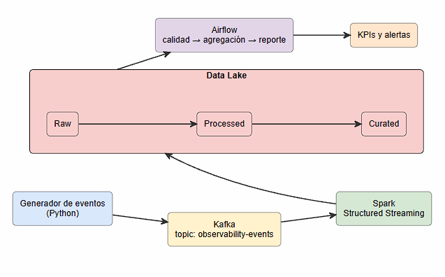

# RapidGo — Observabilidad Tecnológica

Proyecto Final de Big Data: pipeline end-to-end para observar la degradación de las APIs y servicios de RapidGo.

## Equipo

| Integrante | Usuario de GitHub | Responsabilidades principales |
|---|---|---|
| Juan Sebastián Organista Ramirez | [@Sebas7ianRamirez](https://github.com/Sebas7ianRamirez) | Kafka (topic y ADR-001), producer, Spark en Docker, Airflow, README y releases |
| Joseph Santiago Morales Carrillo | [@JsantiagoM21](https://github.com/JsantiagoM21) | Contrato de datos, KPIs y alertas, Spark Structured Streaming |
| Richard Jesus Chachalo Madriñan | [@RichardChachalo](https://github.com/RichardChachalo) | Arquitectura, Docker Compose base, pruebas, CI, ADR-002 y checkpoint de la Semana 2 |

## Problema de negocio

RapidGo requiere detectar oportunamente la degradación de sus APIs y servicios. Actualmente no se tiene una visión unificada de errores, latencia y disponibilidad por servicio, lo que dificulta identificar incidentes y actuar a tiempo.

## Variante asignada

**Variante 9 — Observabilidad tecnológica.**

El sistema captura eventos operacionales de APIs, los transporta mediante Kafka, los procesa con Spark Structured Streaming y genera indicadores y alertas sobre la salud de los servicios.

## Arquitectura



El flujo general es:

```text
Generador de eventos -> Kafka -> Spark Structured Streaming -> Data Lake -> Airflow -> Indicadores y alertas
```

- **Generador de eventos:** simula eventos de `pedidos-api`, `pagos-api`, `tracking-api` y `usuarios-api`.
- **Kafka:** transporta los eventos mediante el topic `rapidgo.observabilidad.eventos`.
- **Spark Structured Streaming:** consume, valida y procesa los eventos; calcula KPIs y escribe resultados en el Data Lake.
- **Data Lake:** organiza la información en las capas `raw`, `processed` y `curated`.
- **Airflow:** orquestará tareas de calidad, agregación y reporte (Semana 3). El servicio ya está disponible en Docker.
- **Indicadores y alertas:** error rate, latencia p95, disponibilidad y reglas de alerta.

## Contrato del evento

Los eventos siguen el esquema definido en [`samples/contrato_evento.schema.json`](samples/contrato_evento.schema.json).

Campos principales:

- `event_id`
- `timestamp`
- `servicio`
- `endpoint`
- `metodo_http`
- `codigo_http`
- `latencia_ms`
- `region`
- `instancia`

## KPIs y alertas

Los KPIs iniciales son:

- **Error rate:** porcentaje de eventos con código HTTP mayor o igual a 500.
- **Latencia p95:** percentil 95 de `latencia_ms` por servicio.
- **Disponibilidad:** aproximación basada en `1 - error_rate`.

Las reglas de alerta iniciales son:

- **Error alto:** error rate superior al 5 % en una ventana de 1 minuto.
- **Latencia crítica:** p95 de latencia superior a 2000 ms en una ventana de 1 minuto.

Los detalles están en [`docs/kpis_alertas.md`](docs/kpis_alertas.md).

## Decisiones técnicas

- [ADR-001 — Topic, key y particiones de Kafka](docs/decisions/ADR-001-kafka-topic-key-particiones.md)
- [ADR-002 — Validación y calibración de umbrales de alerta](docs/decisions/ADR-002-validacion-umbrales.md)

## Checkpoints semanales

- [Semana 1](docs/checkpoints/semana1.md)
- [Semana 2](docs/checkpoints/semana2.md)

## Estado actual

La Semana 2 quedó cerrada con el release [`v0.2.0-streaming`](https://github.com/Sebas7ianRamirez/RapidGo_Proyecto-Final/releases/tag/v0.2.0-streaming).

El pipeline implementa:

- Generación y publicación de eventos en Kafka con key `servicio` y escenarios de anomalía.
- Topic `rapidgo.observabilidad.eventos` con 3 particiones.
- Procesamiento con Spark Structured Streaming, ejecutado en Docker.
- Persistencia en Parquet de los eventos válidos (`datalake/processed`) y de los KPIs con alertas (`datalake/curated`).
- Alertas de error rate alto y latencia crítica.
- Pruebas automatizadas y CI con GitHub Actions.
- Airflow 3.3.1 disponible en Docker con el DAG rapidgo_pipeline_observabilidad implementado (Semana 3, Issues #18 y #19), integrando validación de capas, lectura real con Pandas, manejo de retries y transferencia de métricas mediante XCom.

## Cómo ejecutarlo

Prerrequisitos: Docker Desktop (o Docker Engine con Compose v2), Git y Python 3.12 o superior.

```powershell
# 1. Kafka y creación del topic
docker compose up -d

# 2. Entorno de Python (Windows; en Linux: source .venv/bin/activate)
python -m venv .venv
.\.venv\Scripts\Activate.ps1
pip install -r requirements.txt

# 3. Spark en Docker (iniciarlo antes del producer: lee solo eventos nuevos)
docker compose --profile spark up -d spark-streaming

# 4. Producer (por ejemplo, 60 s normales y 180 s de latencia alta en pagos-api)
python -m producer.main --tasa 5 --escenario latencia_alta --anomalia-inicio 60 --anomalia-duracion 180 --max-eventos 2400
```

- Pruebas: `python -m pytest -v`.
- Los Parquet quedan en `datalake/` y los checkpoints de Spark en `spark-checkpoints/`; ambas carpetas están en `.gitignore`.
- Pausar sin perder datos: `docker compose stop` y luego `docker compose start`. Con `docker compose down` se pierden los mensajes del topic.
- Detalles de Spark: [`spark/README.md`](spark/README.md).

## Airflow

```powershell
docker compose --profile airflow up -d airflow
docker compose logs airflow | Select-String "password"
```

- Interfaz web: <http://localhost:8088> (solo accesible desde la máquina local).
- Los DAGs se leen de `airflow/dags`, montada en el contenedor (con el datalake integrado en modo de solo lectura :ro).
- La contraseña del usuario administrador se genera al primer arranque y se muestra en los logs.
- **Versión:** Airflow 3.3.1, la versión estable que muestra la documentación oficial; la imagen `apache/airflow:3.3.1` está disponible. Se usa el modo `standalone` con SQLite en un solo contenedor, porque el compose oficial con Celery y Redis exige más memoria (la documentación pide al menos 4 GB para Docker) y aquí comparte recursos con Kafka y Spark. Es suficiente para un DAG lineal; no soporta tareas en paralelo.
- El historial de ejecuciones vive dentro del contenedor: usar `docker compose stop` y `start`, no `down`.

## Contribuciones

| Integrante | Pull Requests principales (Issue) |
|---|---|
| Juan Sebastián Organista Ramirez | #35 ADR-001 (#6), #38 README y plantilla de PR (#8), #39 topic de Kafka (#10), #40 producer (#9), #49 documentación de la Semana 2, #50 conector Kafka de Spark, #51 Spark en Docker (#17) |
| Joseph Santiago Morales Carrillo | #33 contrato JSON (#3), #34 KPIs y alertas (#4), #41 lectura y parseo con Spark (#11), #43 transformaciones y ventanas (#12), #45 alertas, Parquet y checkpoint (#13) |
| Richard Jesus Chachalo Madriñan | #36 arquitectura (#5), #37 compose base (#7), #46 pruebas (#14), #47 CI (#15), #48 ADR-002 y checkpoint de la Semana 2 (#16) |

## Plan de las siguientes semanas

- **Semana 3:** DAG de Airflow con tareas, dependencias, retries, XCom, calidad y resiliencia.
- **Semana 4:** integración final, quality gate, release `v1.0.0` y video final.