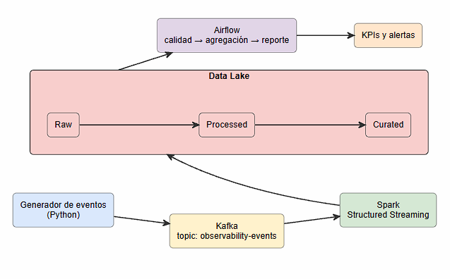

# RapidGo — Observabilidad Tecnológica

Proyecto Final de Big Data: pipeline end-to-end para observar la degradación de las APIs y servicios de RapidGo.

## Equipo

| Integrante | Usuario de GitHub | Responsabilidades principales |
|---|---|---|
| Juan Sebastián Ramírez | [@Sebas7ianRamirez](https://github.com/Sebas7ianRamirez) | Infraestructura, proceso, productor, Airflow y release |
| Joseph Santiago | [@JsantiagoM21](https://github.com/JsantiagoM21) | Contrato de datos, KPIs, Spark, pruebas y CI |
| Richard | [@Richard-usuario](https://github.com/Richard-usuario) | Arquitectura, Kafka, Docker Compose, CI y documentación |

> Reemplaza el usuario y nombre de Richard por los datos reales antes de hacer el PR.

## Problema de negocio

RapidGo requiere detectar oportunamente la degradación de sus APIs y servicios. Actualmente no se tiene una visión unificada de errores, latencia y disponibilidad por servicio, lo que dificulta identificar incidentes y actuar a tiempo.

## Variante asignada

**Variante 9 — Observabilidad tecnológica.**

El sistema captura eventos operacionales de APIs, los transporta mediante Kafka, los procesa con Spark Structured Streaming y genera indicadores y alertas sobre la salud de los servicios.

## Arquitectura



El flujo general es:

```text
Generador de eventos -> Kafka -> Spark Structured Streaming -> Data Lake -> Airflow -> Indicadores y alertas
```

- **Generador de eventos:** simula eventos de `pedidos-api`, `pagos-api`, `tracking-api` y `usuarios-api`.
- **Kafka:** transporta los eventos mediante el topic `rapidgo.observabilidad.eventos`.
- **Spark Structured Streaming:** consume, valida y procesa los eventos; calcula KPIs y escribe resultados en el Data Lake.
- **Data Lake:** organiza la información en las capas `raw`, `processed` y `curated`.
- **Airflow:** orquestará tareas de calidad, agregación y reporte en las siguientes semanas.
- **Indicadores y alertas:** error rate, latencia p95, disponibilidad y reglas de alerta.

## Contrato del evento

Los eventos siguen el esquema definido en [`samples/contrato_evento.schema.json`](samples/contrato_evento.schema.json).

Campos principales:

- `event_id`
- `timestamp`
- `servicio`
- `endpoint`
- `metodo_http`
- `codigo_http`
- `latencia_ms`
- `region`
- `instancia`

## KPIs y alertas

Los KPIs iniciales son:

- **Error rate:** porcentaje de eventos con código HTTP mayor o igual a 500.
- **Latencia p95:** percentil 95 de `latencia_ms` por servicio.
- **Disponibilidad:** aproximación basada en `1 - error_rate`.

Las reglas de alerta iniciales son:

- **Error alto:** error rate superior al 5 % en una ventana de 1 minuto.
- **Latencia crítica:** p95 de latencia superior a 2000 ms en una ventana de 1 minuto.

Los detalles están en [`docs/kpis_alertas.md`](docs/kpis_alertas.md).

## Decisiones técnicas

- [ADR-001 — Topic, key y particiones de Kafka](docs/decisions/ADR-001-kafka-topic-key-particiones.md)

## Estado actual

En la Semana 1 se definieron la arquitectura, el contrato del evento, los KPIs, las reglas de alerta y la decisión inicial de Kafka. El pipeline ejecutable con Docker, Spark, Airflow y GitHub Actions se implementará en las siguientes semanas.

## Plan de las siguientes semanas

- **Semana 2:** producer funcional, Kafka, Spark Structured Streaming, Data Lake, pruebas y CI.
- **Semana 3:** orquestación con Airflow, calidad, resiliencia y recuperación ante fallos.
- **Semana 4:** integración final, quality gate, release `v1.0.0` y video final.