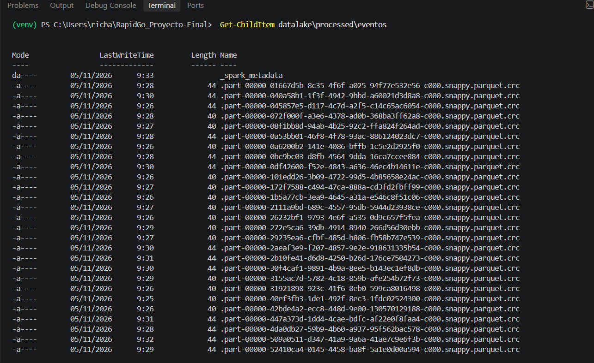
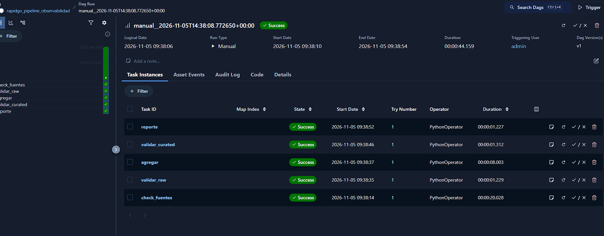
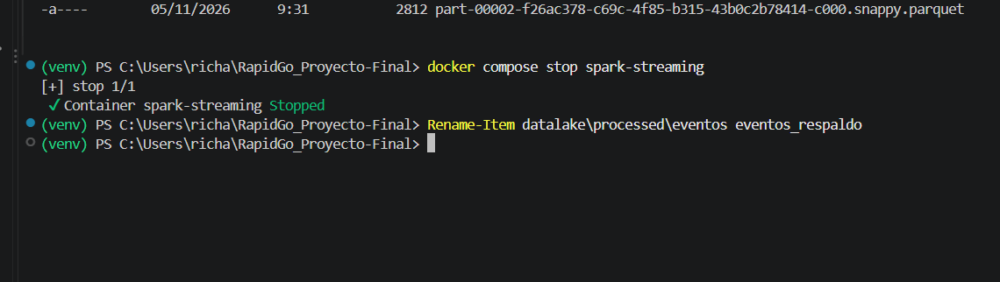
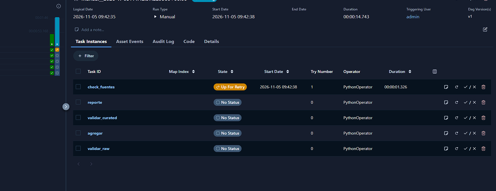
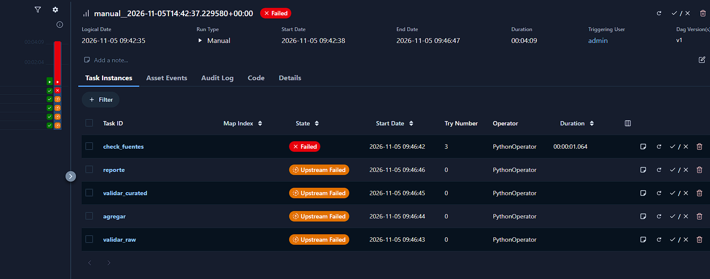
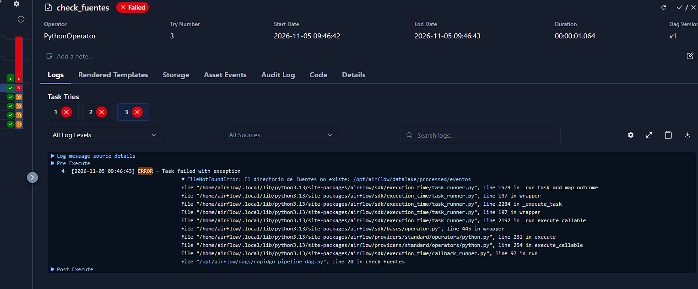
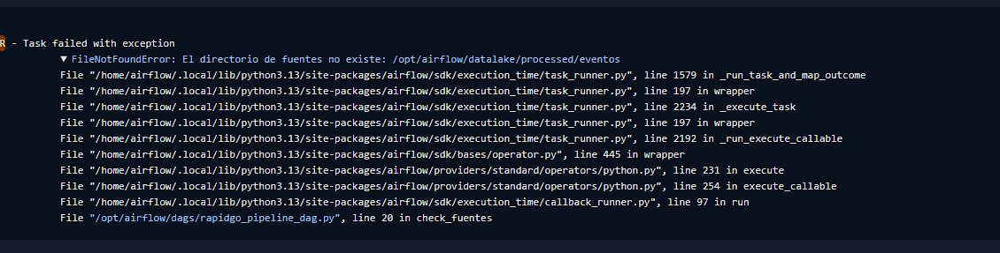

# Fallo controlado y recuperación del DAG (Issue #23)

## 1. Objetivo
Provocar un fallo controlado en el DAG `rapidgo_pipeline_observabilidad`, documentar el error real y demostrar que el sistema se recupera al solucionar la causa raíz.

## 2. Escenario elegido y justificación
Se eligió simular la **ausencia de la capa Raw/Processed**. Aunque el Issue menciona "Kafka detenido", el DAG actual no se conecta a Kafka (solo lee archivos Parquet locales), por lo que apagar Kafka no haría fallar las tareas. Al renombrar la carpeta `datalake/processed/eventos`, forzamos que la primera tarea (`check_fuentes`) falle al no encontrar los archivos.

## 3. Procedimiento reproducible
1. Verificar que existen datos previos en `datalake/processed/eventos` y `datalake/curated/kpis_alertas`.
   
   

2. Disparar el DAG y confirmar línea base exitosa.
   
3. Detener Spark y renombrar la carpeta: `Rename-Item datalake\processed\eventos eventos_respaldo`.
   
4. Disparar el DAG, esperar los reintentos y documentar el fallo.

## 4. Fallo provocado y tareas afectadas
Al faltar la carpeta, la tarea `check_fuentes` entró en estado de reintento (`up_for_retry`).


Tras agotar los 2 reintentos configurados, la tarea falló definitivamente y bloqueó a las demás.


| Tarea | Estado final | Causa |
| :--- | :--- | :--- |
| `check_fuentes` | failed | FileNotFoundError: No existe la ruta o no hay archivos .parquet |
| `validar_raw` | upstream_failed | Dependencia directa fallida |
| `agregar` | upstream_failed | Dependencia directa fallida |
| `validar_curated` | upstream_failed | Dependencia directa fallida |
| `reporte` | upstream_failed | Dependencia directa fallida |

En la vista de instancias de tareas se evidencia el número de intentos (Try Number 1, 2 y 3).


## 5. Log real de la tarea fallida
El log de Airflow muestra el traceback exacto del fallo de la ruta:


```text
FileNotFoundError: [Errno 2] No such file or directory: '/opt/airflow/datalake/processed/eventos'